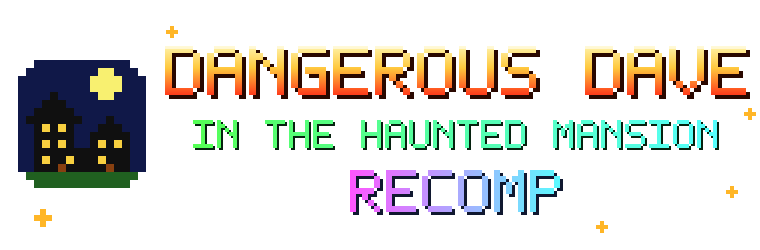
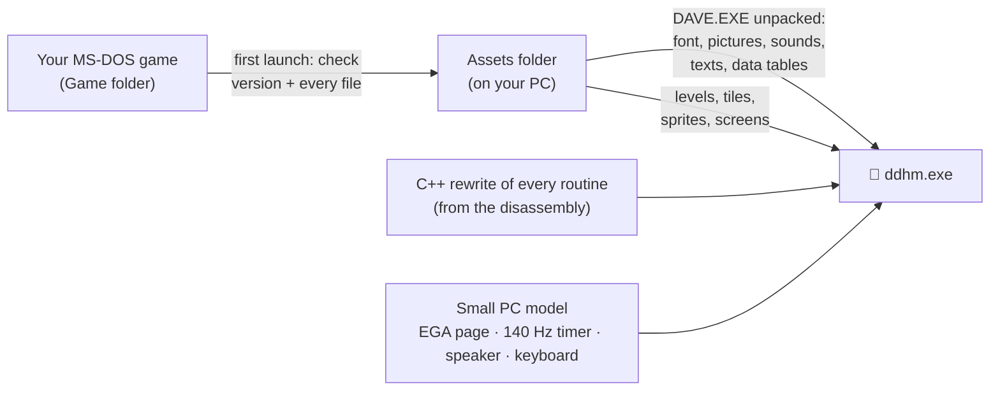

  

  <b>Softdisk's 1991 DOS classic <i>Dangerous Dave in the Haunted Mansion</i>, rebuilt in C++ to run natively on Windows.</b> 
  No DOSBox, no game files included &mdash; bring your own copy of the MS-DOS game and play.

  
  
  
  

<!-- Screenshots are not included on purpose: they would be the original game's artwork. -->

> [!IMPORTANT]
> **This project contains no game data.** You need your own copy of the original MS-DOS game: the Softdisk release,
> **version 1.12** (`DAVE.EXE`, 84,222 bytes, plus its `.DD2` files). Please only use a copy you are legally
> entitled to use. Don't ask for the game files here.

---

## ✨ Highlights

- 👻 **The real game, natively** &mdash; every routine of the original 16-bit program (Dave, all enemies and both
  bosses, doors, scoring, title, level intros, death scenes, menus, sound) was reverse-engineered from the
  disassembly and rewritten in C++. No DOSBox, and no emulator runs the game's code.
- 🔒 **Ships nothing copyrighted** &mdash; the download contains only this project's own code. Your copy of the game
  supplies the graphics, sounds, texts and data tables; a test scans the released programs for every byte block and
  every string of the game files and finds none.
- 🚪 **Simple setup** &mdash; drop the DOS game into the `Game` folder and start **DDHM Launcher**. It checks your
  files and extracts what the port needs into `Assets` on the first launch.
- ⏱️ **Original feel** &mdash; the 70 Hz frame rate, the 140 Hz game timer, the EGA palette fades and the windows and
  text drawn exactly like the original, including the white hit flash and the sliding title screen.
- 🔊 **PC-speaker sound** &mdash; all 24 sound effects play from the game's own data with their original priorities,
  plus an optional softer sound.
- 🕹️ **Everything from the original** &mdash; F1 help, F3 key set-up, TAB status window, high score, *continue from
  level*, the ending, and the developers' debug keys (god mode, level warp).
- 🎮 **Keyboard and gamepad**, 4:3 or square pixels, resizable window and full screen.

## 🚀 Getting started

1. Download the latest release from the [**Releases**](../../releases) page and unzip it anywhere.
2. Extract your copy of the MS-DOS game into the **`Game`** folder (`DAVE.EXE`, `EGATILES.DD2`, `LEVEL01.DD2` …).
3. Start **`DDHM Launcher.exe`** and press **Play**.

On the first launch the launcher checks your files and creates an `Assets` folder next to it. Your `Game` folder is
only read &mdash; never changed, moved or deleted. Changed your game files? Press **Extract assets again**.

> [!TIP]
> Windows may show *"Windows protected your PC"* for a newly downloaded program. Click
> **More info → Run anyway**. The game isn't code-signed, which is normal for free hobby projects.

## 🎮 Controls

The original controls, as listed by the game's own F1 help:

| Action | Keyboard | Gamepad |
|---|---|---|
| Move | `←` `→` | D-pad / left stick |
| Aim up / down | `↑` `↓` | D-pad / left stick |
| Jump | `Ctrl` (also `Space`, `Z`) | A |
| Fire | `Alt` (also `X`) | B or X |
| Drop through a floor | `↓` + `Ctrl` | down + A |
| Open a door / go through it | `↑`, then `↑` again | up |
| Help · sound · keys · gamepad · reset | `F1` · `F2` · `F3` · `F4` · `F5` | |
| Status window | `Tab` | |
| Quit | `Esc` | |
| Full screen | `F11` or `Alt`+`Enter` | |
| 4:3 / square pixels · softer sound | `F9` · `F8` | |

Debug keys of the original developers

Hold the letter and press `F12`: **G** god mode · **W** warp to a level · **P** pause · **S** single-step ·
**F** 1,600-point bonus.

## ⚙️ Settings

The launcher has check boxes for **full screen**, **square pixels** and **softer sound**. They are stored with your
key set-up and the high score in `%APPDATA%\DDHM-Recomp\DDHM` (`ddhm.ini` and the game's own `CTLPANEL.DD2`; one from
your DOS copy in the `Game` folder is imported the first time).

## 🛠️ How it works

The 1991 game is a Borland C++ program for 16-bit DOS with EGA graphics, packed with LZEXE. This project unpacked
it, mapped its routines and data, and rewrote the game in C++: the object system and frame loop, Dave's physics, seven
kinds of enemies, two bosses, doors and secrets, and everything around the play loop. Only *addresses and layouts*
are in the source; the actual tables (sprite records, object states, collision, the random-number table) are read
from your own `DAVE.EXE` when the game starts.

The original program waits for keys and screen retraces in long sequential routines. The port keeps that structure
and runs it on a small model of the PC (EGA page with pixel panning, the 140 Hz timer with its PC-speaker player and
the keyboard interrupt's key table), so title, intros, windows and timing behave as before.

Everything was checked against the disassembly, without an emulator: unit tests with hand-derived values, headless
runs of the whole program with timing and sound checks, screen-checksum regression, and play-testing.

More detail: [program flow, screens and sound](docs/FLOW.md) · [file formats](docs/FORMATS.md) ·
[player](docs/PLAYER.md) · [enemies](docs/ENEMIES.md) · [doors](docs/DOORS.md) · [roadmap](docs/ROADMAP.md)

## 🧱 Building from source

You need Windows, CMake, and LLVM-MinGW (clang) + Ninja or Visual Studio 2022. CMake downloads SDL3 itself. See the
[**development guide**](docs/DEVELOPMENT.md) for the steps, tools and tests.

## ❓ FAQ

**Where do I get the game?**
This project can't help with that. Use a copy you're legally entitled to use, for example from your own Softdisk disk.

**The launcher says the game files are missing or not usable.**
It lists what's missing. Only the Softdisk release version 1.12 is supported (`DAVE.EXE`, 84,222 bytes); other
versions, the *Rooms of Doom* re-release and changed files are refused.

**Is this an emulator?**
No. The game's logic is native C++. What remains is a small model of the hardware the game draws, plays sound and
reads keys through: the EGA screen, the timer and speaker, and the keyboard.

**Can I share my `Assets` folder?**
No &mdash; it contains data from your copy of the game. Share only the release zip.

## 🙏 Credits & licence

- *Dangerous Dave in the Haunted Mansion* &copy; 1991–93 Softdisk Publishing. Programming by John Carmack and John
  Romero, game design by Tom Hall, artwork by Adrian Carmack. This is an unofficial, non-commercial fan project, not
  affiliated with or endorsed by the copyright holders.
- [SDL3](https://www.libsdl.org/) (zlib licence) for the window, input and audio.
- Developed with assistance from [Claude](https://claude.com/claude-code) by Anthropic.

This project's own code is released under the [MIT licence](LICENSE) &copy; 2026 Syncr0ndi.
The licence covers only this project's code, not the game itself. Third-party details are in
[THIRD_PARTY_NOTICES.md](THIRD_PARTY_NOTICES.md).
